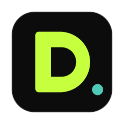

<p align="center">
  
</p>

<h1 align="center">Deck</h1>

<p align="center">
  A private, all-in-one productivity app for the Mac menu bar.
</p>

<p align="center">
  
  
  
</p>

Deck brings together the small tools you reach for every day: file conversion, file search, a focus timer, your calendar and tasks, notes, downloads and a system monitor. It is a native SwiftUI app, it lives in the menu bar, and everything it does stays on your Mac.

## Install

1. Download the latest `.dmg` from [Releases](https://github.com/BoredDog/Deck/releases/latest).
2. Open it and drag **Deck** into **Applications**.
3. The first time you open Deck, right-click it and choose **Open**. Deck isn't notarized by Apple yet, so macOS asks once. If you only see "Done", go to **System Settings → Privacy & Security** and click **Open Anyway**.
4. Deck appears in the menu bar. It shows in the Dock only while its window is open.

Everyday conversions use tools already built into macOS. For everything else, Deck uses free helpers such as ffmpeg, pandoc and ImageMagick, installed through [Homebrew](https://brew.sh). You can install them all at once (about 1.5 GB) or let Deck fetch each one the first time you need it.

## Features

| Area | What it does |
|---|---|
| **Files** | Converts around 80 formats (images, video, audio, documents, Excel, PowerPoint, LaTeX). Makes files smaller, with exact restore for lossless formats. Copies text from images and PDFs, edits PDFs, removes backgrounds, renames in bulk, finds duplicates and tidies Downloads. Also available from Finder's right-click menu. Originals are never changed. |
| **Find** | Searches every file on the Mac by name, including hidden and system files. |
| **Mac** | Shows CPU, memory, disk, network, battery, temperatures and fans. Cleans caches and old backups, and removes apps together with their leftovers. |
| **Downloads** | Fast, resumable downloads powered by aria2, including torrents and metalinks. |
| **Plan** | Your calendars and reminders from iCloud, Google or Outlook (through macOS accounts), quick add in plain language, habits, a weekly review and a journal. |
| **Focus** | A focus timer that blocks distracting sites and apps, background sounds, break reminders, music controls and an equalizer with per-app volume. Your FineTune equalizer settings can be imported. |
| **Notes** | Markdown notes saved as plain files, with optional encrypted private notes. |
| **Inbox** | One place for everything Deck does. Notifications wait until your focus session ends. |

### Menu bar and quick panel

Click the D in the menu bar for a compact panel, or open the quick panel from anywhere by double-tapping **Option**, moving the pointer into the top-right corner, or pressing **⌃⌥Space**. Both can show the focus timer, your next event, the current download, what's playing (tap it to see every app making sound, with its own volume), the equalizer, a quick note, clipboard history and Keep awake. Choose which tiles appear in Settings.

### Also included

- Clipboard history with pictures, in its own window. Passwords are never stored, and it is off in the panel until you turn it on.
- Keep awake: until you turn it off, for an hour or two, or until downloads finish.
- Weather, if you turn it on.
- Several color themes, a personal greeting on Home and a short quote at the bottom of the window.

## Privacy

- No accounts, analytics or cloud services.
- Deck only connects to the internet for things you start (downloads, installing helpers), update checks against GitHub, and the weather if you enable it. Your location is rounded to about 1 km before it is sent to Open-Meteo.
- File converters run with network access blocked.
- Clipboard history, journal entries and private notes are encrypted with a key stored in your Keychain.

## Permissions

Deck explains each permission before macOS asks for it. Everything else keeps working if you decline.

| Permission | Used for | If you decline |
|---|---|---|
| Calendars and Reminders | Plan | Plan stays empty |
| Notifications | Finished downloads, upcoming events, breaks | Everything still appears in Inbox |
| Accessibility | The Option double-tap (only that key is watched) | Use the shortcut or the corner instead |
| Location | Weather | No weather |
| Automation | Music controls, exporting Pages, Numbers and Keynote files | Those controls are unavailable |
| System audio recording | The equalizer (nothing is recorded) | No equalizer |
| Full Disk Access | Find and Storage outside your home folder | Only your home folder is searched |
| Login Items | A helper for site blocking and fan control | You enter your password each time you block sites |
| Keychain | The encryption key | Private data stays in memory only |

## Building from source

Requires Xcode with Swift 6.

```sh
scripts/bundle.sh     # build and install to /Applications
swift test            # run the tests
scripts/make-dmg.sh   # build the release DMG
```

`scripts/bundle-xcode.sh` additionally builds the Notification Center widgets (requires XcodeGen). Copies built from source update themselves by pulling from GitHub and rebuilding; copies installed from the DMG check GitHub Releases.

Releases are published by pushing a version tag (for example `v1.1`); GitHub Actions builds the DMG and attaches it to the release.

## Credits

Deck builds on these open-source projects:

- [KeyboardShortcuts](https://github.com/sindresorhus/KeyboardShortcuts), [MenuBarExtraAccess](https://github.com/orchetect/MenuBarExtraAccess), [Yams](https://github.com/jpsim/Yams), [ZIPFoundation](https://github.com/weichsel/ZIPFoundation), [CodeEditTextView](https://github.com/CodeEditApp/CodeEditTextView) and [Textual](https://github.com/gonzalezreal/textual)
- [mediaremote-adapter](https://github.com/ungive/mediaremote-adapter) (BSD-3, bundled) for Now Playing
- [AudioCap](https://github.com/insidegui/AudioCap) (BSD-2, adapted) for the equalizer
- [Stats](https://github.com/exelban/stats) (MIT, adapted) for sensor and fan readings

Helpers installed through Homebrew: ffmpeg, pandoc, ImageMagick, aria2, zstd, xz, libjxl, oxipng, FLAC, qpdf, Ghostscript, WebP, libheif and 7-Zip. Optional add-ons: LibreOffice, Tectonic, fontTools and yt-dlp.

## License

Deck is released under the [GPL-3.0 license](LICENSE). You are free to use, modify and share it; modified versions you distribute must also be open source under the same license.
